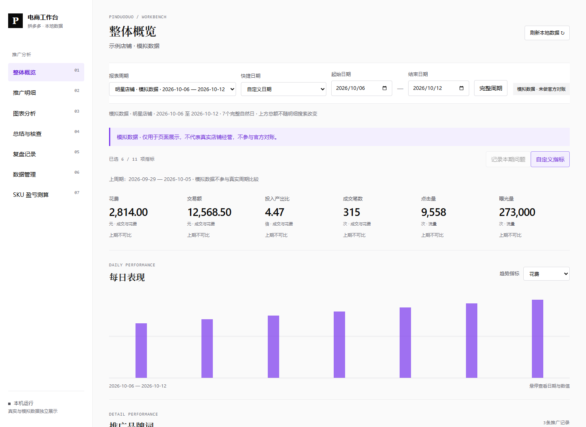
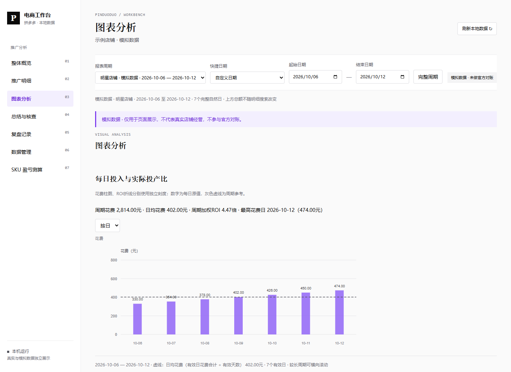
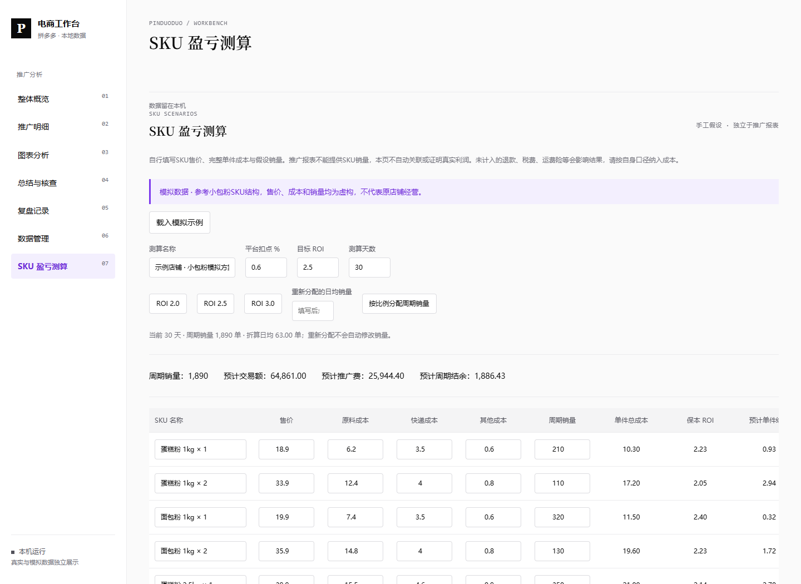
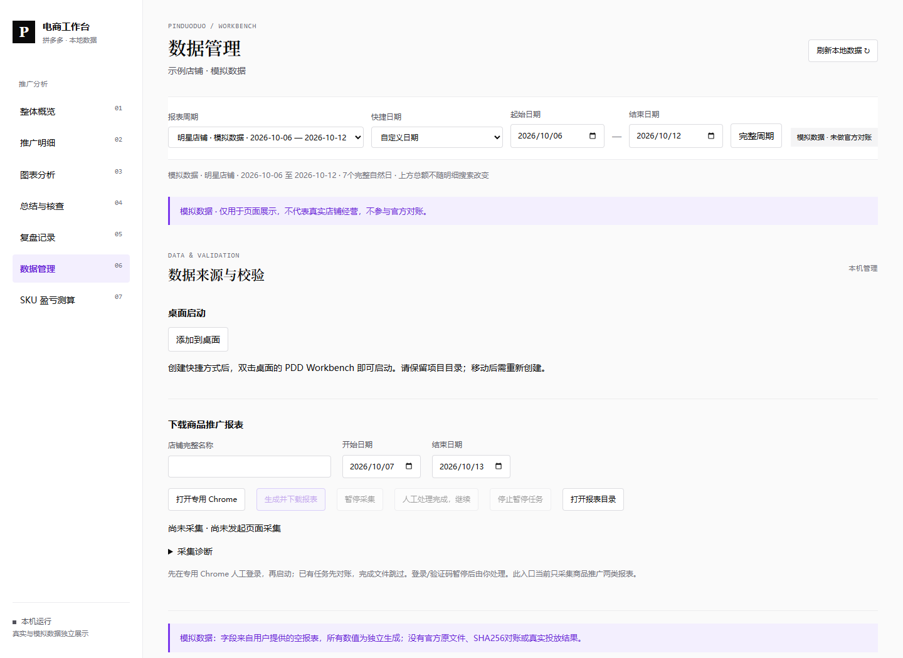

# 拼多多推广报表与本地工作台

Windows 本地工具：人工登录专用 Chrome 后，生成、下载并校验商品推广的分天与汇总报表，在本机分析指标。当前版本 1.0。


## 页面介绍

以下截图全部使用独立虚构示例，不含真实店铺报表。真实自动下载目前支持商品推广；直播/明星店铺仅作演示。

### 指标概览

查看日期范围、指标选择与每日表现，支持真实批次校验后分析。



### 趋势与对比

日期、数值、参考线和按日/周选择，让花费与ROI变化更容易查看。



### SKU盈亏测算

手工填写售价、成本、假设销量和ROI；本机保存及导出。测算不代表真实利润。



### 下载和桌面启动

打开专用Chrome后人工登录，选择日期生成下载；可一键创建当前用户的桌面快捷方式。



## 安装与启动

需要 Windows 10/11、Python 3.12（安装时启用 py 启动器）、已安装 Google Chrome，以及访问拼多多推广后台的账号权限。下载源码 ZIP 后完整解压到可写目录。在项目目录打开 PowerShell：

```powershell
powershell.exe -NoProfile -ExecutionPolicy Bypass -File .\install.ps1
```

安装完成后双击 `start-workbench.cmd`，打开 http://127.0.0.1:5191/ 。没有真实报表时展示明确标注的模拟数据。依赖首次安装需要网络；未要求下载额外 Chromium，使用已安装 Chrome。

## 第一次采集

1. 进入“数据管理”，填写后台完整店铺名称，打开专用 Chrome。
2. 在这个窗口人工登录，并进入官方“工具 → 报表下载”页面：https://yingxiao.pinduoduo.com/tools/report/download 。验证码由本人处理。
3. 选择起止日期，点击“生成并下载报表”。日期应为已结束的完整自然日，不能包含今天或未来。
4. 等待生成、下载与校验完成，再查看真实批次。已有任务先匹配，已完成文件重新校验后跳过。

暂停在安全检查点生效；人工处理完成后点继续。采集中不要重启服务，不切换店铺账号，不同时运行另一份项目操作同一专用浏览器。

## 使用 Codex / WorkBuddy

把项目目录交给支持本机命令执行的 Agent，要求先读 README.md 和 AGENTS.md。工具通过 Python 命令工作，不依赖特定 Agent 专属接口；不同 Agent 的执行权限与配置由使用者设置，尚未逐一验收。

例如指令：“打开本项目专用 Chrome，等我完成登录后，下载我指定店铺和日期的商品推广分天及汇总报表，校验后报告结果；不要读取登录凭证、上传数据或修改投放。”

```powershell
.\.venv\Scripts\python.exe scripts\launch_browser.py
# 人工登录后执行；替换店铺与日期，以下日期只是示例
.\.venv\Scripts\python.exe scripts\collect_reports.py --shop '后台完整店铺名称' --start 2026-07-01 --end 2026-07-31 --generate
```

不加 `--generate` 时只下载已有任务。命令行暂停时输入 `continue` 或 `quit`。默认连接经过归属核验的普通专用 Chrome；`--direct-launch` 仅用于诊断。

## 工作台功能

- 日期快捷选择、批次与周期筛选、整体概览、推广明细、图表分析、总结核查、复盘和数据管理。
- 概览和表格指标可搜索、勾选、排序并保存在当前浏览器；完整源字段、总计和注释可查看。
- 商品推广 38 项指标；直播推广 22 项、明星店铺 11 项为独立模拟展示，当前不提供这两类真实自动采集。
- 等长上期比较、TOP 排名、占比、全屏、商品详情。缺少完整数据时不补零；不确定汇总规则的指标保留官方周期值。
- 文件日期、结构、必需字段、有限数值、总计与可比基础指标对账、SHA256 重验；这些检查不能证明后台概览或所有指标都已逐项核验。
- 复盘证据来自已校验报表；模拟场景不能写正式复盘。ROI 按相应分子分母计算，不代表利润。本版不含成本、SKU 利润和全店商品清单。

## 数据与故障处理

报表与任务在 `data/reports/<店铺名称哈希>/<日期范围>/`；复盘在 `data/reviews/`，浏览器本机草稿在当前浏览器存储。复盘 JSON 备份包含所有店铺记录，分享前核对内容。

专用登录环境在 `%LOCALAPPDATA%\PddReportDownloader\browser-profile-chrome`，服务启动日志在同目录的 `workbench-logs`。程序不读取或导出 Cookie、密码、Token；不上传报表，不修改投放。

- 登录或验证码失败：先人工处理，避免重复扫码和连续重试。不承诺免风控。
- 零字节、身份/日期不符或点击结果不确定：停止并核对实际文件，不盲目重复生成下载。
- 崩溃残留锁：核对锁中 PID 和实际进程后人工处理，不自动删锁或结束未知进程。
- 5191 端口被占用：启动器仅复用识别到的工作台；不会停止未知服务。采集完毕后可在前台终端启动服务并用 Ctrl+C 退出。

```powershell
.\.venv\Scripts\python.exe scripts\serve_workbench.py --port 5192
```

仅本机服务，不部署公网。执行前按完整店铺名称核对，尚无平台稳定店铺 ID 和多店独立配置体系。平台页面变化可能导致采集失效。

## 验证与限制

已在开发者本机实际生成、下载并对账商品推广整月和七日报表，重跑跳过已完成文件；普通 Chrome 先登录再连接的流程通过。具体旧登录错误原因未知。

近 90 个完整自然日（2026-07-15 至 2026-10-12）的商品推广分天及汇总已实际生成、下载并通过 7 项基础指标对账，重跑重验后跳过。三个月前整月仅日期选择通过，完整下载尚未验收。平台权限、历史查询跨度和报表保留期以实际后台为准，不保证任意历史都可导出。

三页模拟任务列表通过生产扫描函数验收；真实验证码后的完整恢复、真实多页任务列表、另一台全新 Windows 的安装与首次登录尚未验收。发布包的本机干净目录测试不替代这些检查。详见 RELEASE-CHECKLIST.md。

无店铺数据测试：

```powershell
.\.venv\Scripts\python.exe scripts\test_audit_regressions.py
.\.venv\Scripts\python.exe scripts\test_clean_start.py
```

## 许可与实现来源

本项目采用 MIT 许可证，见 LICENSE；依赖见 THIRD_PARTY_NOTICES.md。浏览器启动后连接、任务持久化、提交前对账、人工暂停和下载校验借鉴 Accio 研究中的流程思路并独立实现。发布包不含第三方提取代码或逆向资料。界面延续电商工作台的布局，采用 Quiet Signal 的克制视觉原则；不分发其上游资料。


## 桌面快捷方式与SKU测算

在数据管理中点击“添加到桌面”，即可为当前用户创建 PDD Workbench 快捷方式，双击启动本机工作台。也可运行 create-desktop-shortcut.ps1。每个使用者自动绑定自己的项目目录，项目移动后需删除旧快捷方式再重新创建；安装后仍需保留完整目录。不会覆盖指向其他目录的同名快捷方式。

SKU盈亏测算独立于推广报表，售价、原料、快递、其他成本、销量、扣点与目标ROI均由用户手工填写。支持ROI情景、按日均销量和现有比例分配整数周期销量、JSON导入导出、CSV导出及浏览器本地保存。没有SKU销量自动采集，不显示为真实利润；应自行纳入退款和税费等成本。首次展示8个虚构SKU示例并明确标注模拟，可清空后填写自己的数据；不包含作者的真实店铺/SKU资料。当前仅单个测算方案，不包含原参考工具的多店并行或历史实绩对比。

测算页提供当前销量折算日均、无效输入隐藏旧结果、新建我的测算及撤销最近一次删除。图表提供周期摘要及按日/周查看，周ROI重算而非平均，首尾不完整周明确提示。桌面启动失败显示错误与日志位置；命令行NoOpen模式仍只输出错误。
